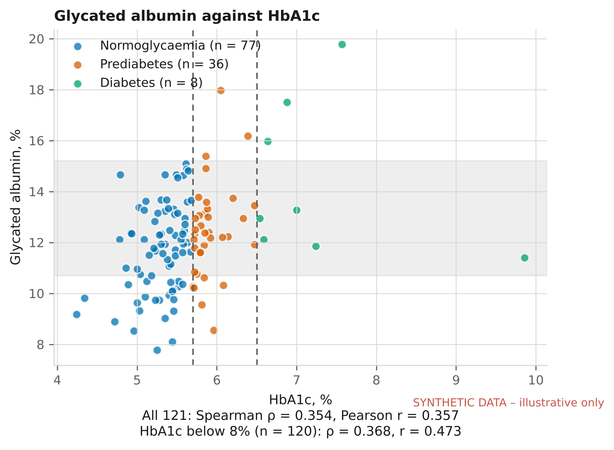
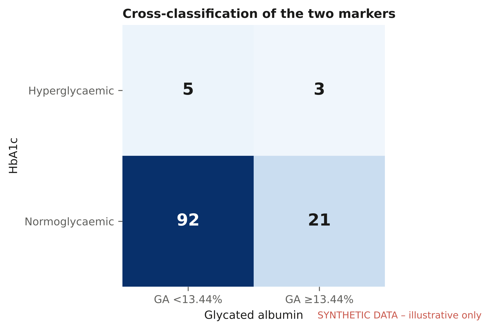

# HbA1c vs glycated albumin in people living with HIV on dolutegravir

Analysis code for my MSc Clinical Biochemistry dissertation (University of Zimbabwe, 2026):

> *Comparative Analysis of HbA1c and Glycated Albumin for Classifying Hyperglycaemia, and Their Association with Hypertension and the Atherogenic Index of Plasma, in People Living with HIV on Dolutegravir-Based Antiretroviral Therapy*

**The data in this repository are synthetic.** The study data are confidential clinical records and are not shared. `src/make_synthetic_data.py` generates a dataset with the same schema from a hand-specified parametric model, so the whole pipeline runs end to end. Figures made from synthetic data carry a red watermark, and nothing in them should be read as a study result.

## Scientific question

HbA1c and glycated albumin (GA%) both index average glycaemia, but each can be distorted for reasons unrelated to glucose:

| Marker | Time window | Fails through |
|---|---|---|
| HbA1c | ~2–3 months | erythrocyte lifespan and turnover, haemoglobin variants, anaemia |
| GA% (GA / total albumin × 100) | ~2–3 weeks | albumin turnover, hypoalbuminaemia, protein-losing states |

People living with HIV on dolutegravir-based ART carry several of these distorting factors. The study treats disagreement between the two markers as a clinically informative signal, not as measurement noise. It then asks whether either marker is associated with hypertension and with the Atherogenic Index of Plasma, AIP = log10(TG/HDL-C).

## What the pipeline does

`src/analysis.py` runs, in order:

1. **Derivation and QC**: BMI, GA%, AIP, non-HDL, and Friedewald LDL (suppressed when TG > 4.5 mmol/L). Hypertension is defined as raised pressure (≥140/90) or antihypertensive treatment, detected from free-text medication fields. Records outside physiological limits are flagged.
2. **Descriptive tables**, with Wilson 95% confidence intervals for every proportion.
3. **Method agreement**
   - Passing–Bablok regression, implemented from first principles, because neither marker is a reference standard.
   - CUSUM test for linearity.
   - Spearman and Pearson correlation, overall and with HbA1c below 8% to check leverage from extreme values.
   - Difference plot on standardised scales.
4. **Classification agreement** between HbA1c ≥ 6.5% and GA% ≥ 13.44%: Cohen's κ with 95% CI, McNemar's test, and sensitivity of κ to the GA threshold.
5. **Hypertension models**: logistic regression fitted by Newton–Raphson, adjusted for age, sex and BMI, with variance inflation factors. One model each for GA%, HbA1c and the GA/HbA1c ratio.
6. **Lipids and AIP**: dyslipidaemia prevalence, AIP risk bands, and correlations of each marker with lipid fractions.
7. **Sensitivity analysis** with QC-flagged records excluded.

## Run it

```bash
pip install -r requirements.txt
python src/make_synthetic_data.py      # writes data/synthetic_study_data.csv
python src/analysis.py                 # tables -> outputs/tables, figures -> outputs/figures
```

To run on a real dataset with the same columns, pass its path: `python src/analysis.py path/to/data.xlsx`. `.gitignore` blocks `.xlsx` files and anything under `data/private/` from being committed.

## Example output (synthetic data)

| GA% against HbA1c | Classification agreement |
|---|---|
|  |  |

## Notes on methods

- **Why Passing–Bablok rather than ordinary regression.** OLS assumes the x-variable is measured without error. Passing–Bablok is non-parametric, symmetric in x and y, and robust to outliers, which makes it the standard choice when comparing two methods that are both imperfect.
- **Why GA is expressed as a percentage of albumin.** Expressing GA% relative to total albumin corrects for hypoalbuminaemia. Absolute GA concentration in g/L would confound glycation with albumin level.
- **Why AIP.** The dyslipidaemia seen on dolutegravir is mainly high triglycerides with low HDL, not raised LDL. AIP captures that pattern. It is analysed as a continuous variable; risk bands are only descriptive.

- **Public-version change.** The free-text occupation lookup has been replaced by generic keywords, so that no participant-specific wording is published. Employment counts from this version will therefore not exactly match the dissertation. All laboratory and statistical code is unchanged.

## Author

Watson Mashandudze, MSc Clinical Biochemistry candidate, Chemical Pathology Unit, University of Zimbabwe.
Supervisors: Mrs R. Chirimo, Mr D. Vhanda.

Licence: MIT (code only).
